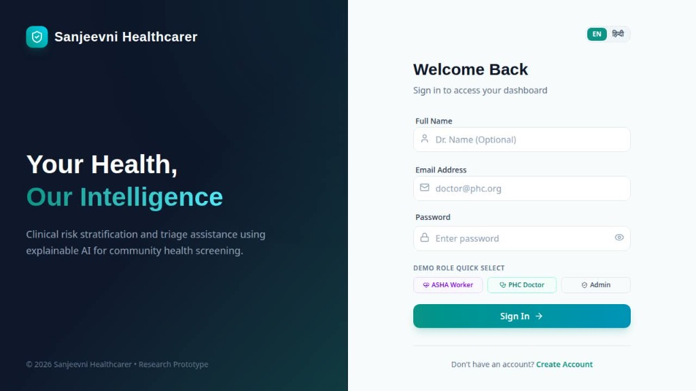
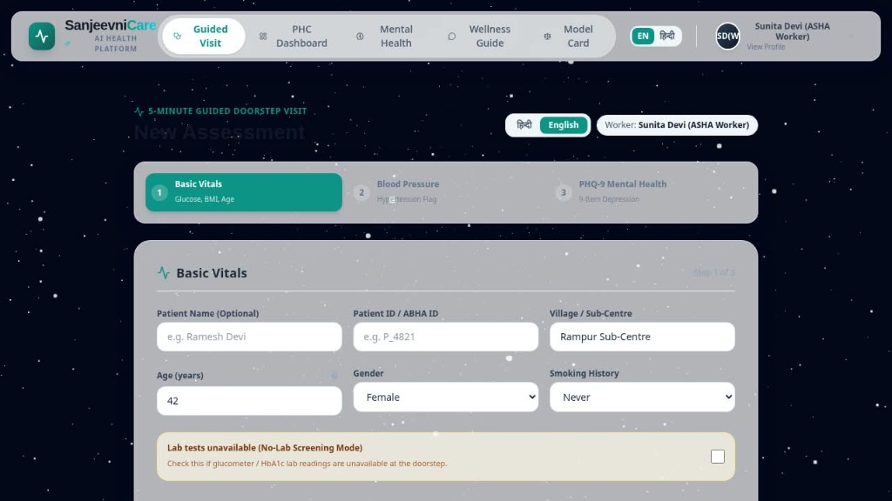
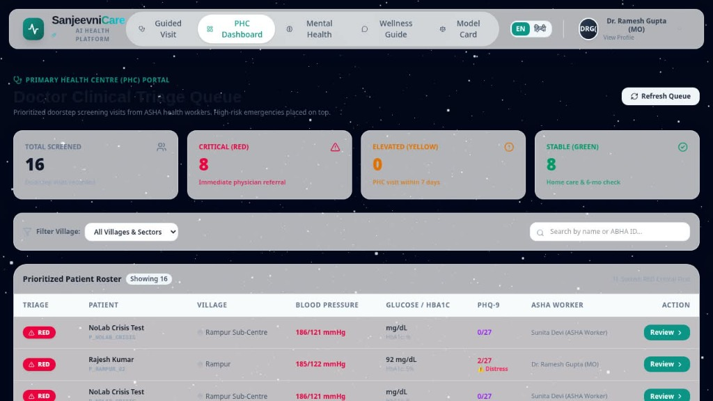
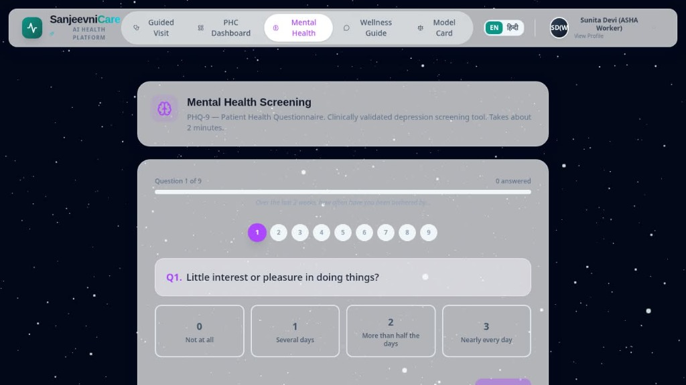
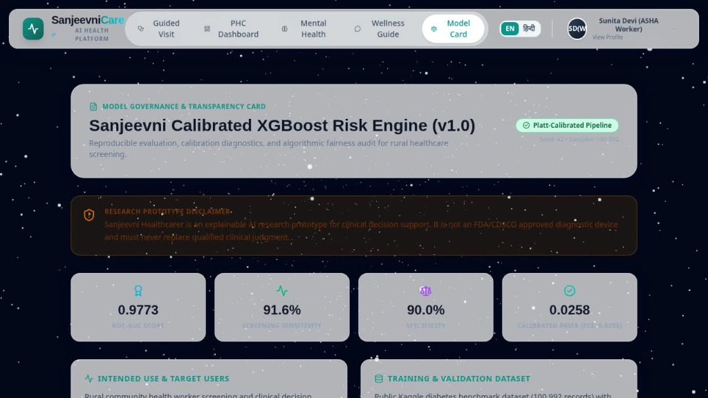
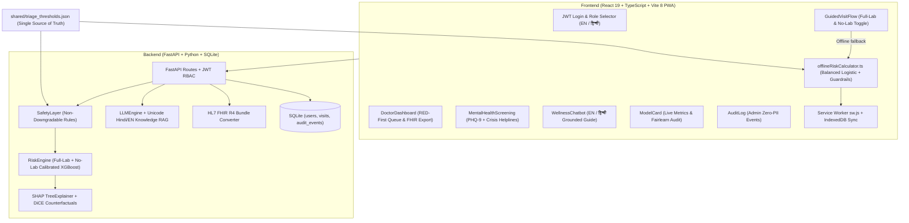

# 🌿 Sanjeevni Healthcarer

### Offline-First, Explainable AI Clinical Screening & Triage Platform for Rural Primary Care

[](https://sanjeevni-healthcare.vercel.app)
[](https://sanjeevni-healthcare.onrender.com/docs)

- **🌐 Live Web App**: https://sanjeevni-healthcare.vercel.app
- **⚙️ Backend API & Swagger Docs**: https://sanjeevni-healthcare.onrender.com/docs
- **🔑 Quick Demo Login**: Use the **Demo Role Quick Select** buttons on the login screen (`worker@sanjeevni.org` / `Password@123`, `doctor@phc.org` / `Password@123`, or `admin@hospital.org` / `password123`).
  *(Note: Backend runs on Render's free tier and may take ~30–50 seconds to wake up on the first request after inactivity.)*

> **⚠️ Research Prototype Disclaimer**: Sanjeevni Healthcarer is an investigational research prototype designed to assist rural Community Health Workers (**ASHA-style workers**) and Primary Health Centre (**PHC**) doctors during community screening visits. It is **not** a diagnostic medical device, never prescribes medication, and must **never** replace clinical examination by a qualified physician. In medical emergencies, dial **112** or **Tele-MANAS 14416**.

---

## 📸 Platform Screenshots

| Login & Bilingual Role Quick-Select (`EN / हिन्दी`) | 5-Minute Guided Doorstep Visit (with No-Lab Toggle) |
|---|---|
|  |  |

| PHC Doctor Clinical Triage Queue (`RED -> YELLOW -> GREEN`) | PHQ-9 Mental Health Screening |
|---|---|
|  |  |

| Model Governance, Calibration & Fairness Card |
|---|
|  |

---

## 1. Core Product Story (5-Minute Guided Doorstep Visit)

Rural health workers typically screen patients in ~5 minutes under intermittent internet connectivity and often without immediate point-of-care lab analyzers. **Sanjeevni Healthcarer** focuses every feature around three roles:

1. **ASHA / Community Health Worker (`worker`)**: Conducts a structured 4-step visit (**Basic Vitals -> Blood Pressure -> PHQ-9 Mental Health -> Triage & Referral**). Works online or offline, speaks/reads results aloud in **English or हिन्दी**, toggles **No-Lab Mode** when glucose/HbA1c readings are absent, and shares follow-up instructions via WhatsApp.
2. **PHC Medical Officer (`doctor`)**: Reviews a village-filterable triage queue sorted strictly **RED -> YELLOW -> GREEN**, inspects patient longitudinal trends, and exports **HL7 FHIR R4 Bundles**.
3. **Health Administrator (`admin`)**: Reviews non-PII authentication and clinical endpoint audit events via `GET /audit`.

---

## 2. System Architecture



---

## 3. What IS Implemented vs. What is NOT Included

### ✅ What IS Implemented & Verified
- **Dual Calibrated ML Pipeline (`backend/models/risk_engine.py`, `scripts/train.py`)**:
  - **Full-Lab Model**: Platt-calibrated XGBoost Classifier (`age`, `gender`, `bmi`, `hypertension`, `heart_disease`, `smoking_history`, `HbA1c_level`, `blood_glucose_level` + interaction/bucket features).
  - **No-Lab Fallback Model**: Automatically routed whenever `HbA1c_level` or `blood_glucose_level` is omitted; clearly labels predictions *"Estimated without lab tests: confirm with a glucometer or lab test"*.
- **Non-Downgradable Deterministic Clinical Safety Layer (`backend/models/safety_layer.py`)**:
  - Reads thresholds from `shared/triage_thresholds.json` (`Glucose >= 300`, `HbA1c >= 12.0`, `BP >= 180/120`, `PHQ-9 Item 9 > 0` self-harm, or `PHQ-9 >= 20` -> **RED**; elevated vitals/ML -> **YELLOW**; routine -> **GREEN**). Can only escalate severity, never downgrade.
- **Online/Offline Single Source of Truth (`shared/triage_thresholds.json`, `frontend/src/utils/offlineRiskCalculator.ts`)**:
  - Uses identical clinical cutoffs and balanced `LogisticRegression` weights fitted via `scripts/fit_offline_logistic.py`.
- **Offline-First PWA (`frontend/public/sw.js`, `frontend/src/utils/offlineSync.ts`)**:
  - App-shell & asset caching (`sanjeevni-shell-v2`), IndexedDB pending visit queue with client-generated UUID idempotency, and automatic background sync when connectivity returns.
- **Explainable AI & Fairness Governance (`backend/models/counterfactuals.py`, `scripts/audit_fairness.py`)**:
  - Sub-2s **SHAP `TreeExplainer`** feature drivers + bilingual English/Hindi plain-language takeaways.
  - **DiCE** actionable counterfactuals strictly constrained to modifiable lifestyle features (`bmi`, `HbA1c_level`, `smoking_history`), never altering `age` or `gender`.
  - **Fairlearn** subgroup evaluation dynamically written into `backend/models/fairness.json`, `docs/MODEL_CARD.md`, and `/model-card`.
- **PHQ-9 Depression Screener & Crisis Protocols (`frontend/src/components/MentalHealthScreening.tsx`)**:
  - Validated 9-item questionnaire + Indian crisis helplines (`Tele-MANAS 14416`, `KIRAN 1800-599-0019`, `iCall`, `AASRA`, `Snehi`, `Emergency 112`).
- **Complete Bilingual UI (English / हिन्दी) & Hindi RAG (`frontend/src/i18n/locales/`, `backend/models/llm_engine.py`, `backend/knowledge/*_hi.txt`)**:
  - 100% translation key parity across `en.json` and `hi.json`.
  - Unicode Devanagari tokenizer (`_tokenize_unicode`) routing Hindi questions to Hindi ADA/AHA/PHQ-9 knowledge docs with citations, emergency keyword interception, and strict out-of-scope refusal (*"जानकारी नहीं है"*).
  - Works completely without any external LLM server (optional `LLM_BASE_URL` / `LLM_MODEL` / `LLM_API_KEY` OpenAI-compatible client).
- **Zero-Trust Auth, RBAC & Audit Logs (`backend/auth.py`, `backend/routes/audit.py`)**:
  - All patient, screening, prediction, simulation, FHIR, cohort, feedback, report, and chat routes enforce JWT verification (`401` redirects frontend to Login).
  - `worker` accounts see only their own visits (`403` on other workers' timelines); `admin`-only `GET /audit` logs zero-PII audit records.
  - Missing `SECRET_KEY` fails startup unless `APP_ENV=development`.
- **HL7 FHIR R4 Bundle Export (`backend/utils/fhir_converter.py`)**:
  - Exports LOINC-coded `Patient`, `Observation`, and `RiskAssessment` resources.

### ❌ What is NOT Included / Current Boundaries (Honest Scope)
- **Not a Certified Medical Device**: Models are trained on a public Kaggle diabetes benchmark dataset (`data/diabetes_dataset.csv`), **not** prospectively validated on Indian rural clinical cohorts.
- **No Separate Cardiac / Renal ML Classifier**: Cardiovascular risk is screened deterministically via Blood Pressure cutoffs (`AHA/ACC`) and comorbid history flags inside the Safety Layer and diabetes ensemble — there is no dedicated cardiac event survival model.
- **No Native Multi-PHC Cloud Database Sync**: Persistence defaults to local SQLite (`clinician_risk.db`); PostgreSQL / ABDM ABHA live health-record push is not integrated.
- **Lightweight Generative Prose Offloaded**: No multi-gigabyte GGUF model is bundled (to remain runnable on 1–2 GB RAM hardware). If `LLM_BASE_URL` is offline, reports/chat run via verified deterministic templates and grounded knowledge retrieval.
- **Deferred Engineering Items (from 48-min roadmap Items 8–12)**: Splitting `dice-ml`/`fairlearn` into `requirements-dev.txt`, GitHub Actions CI `.yml`, expanded Playwright E2E specs across Hindi/No-Lab/offline reload, Render/Vercel free-tier templates, and hackathon submission writeups in `docs/submission/`.

---

## 4. Computed Model & Fairness Metrics

All values below are measured in this repository (`backend/models/metrics.json`, `backend/models/fairness.json`, `shared/triage_thresholds.json`; `RANDOM_SEED = 42`, `80/20` stratified split on `100,992` records, `8.5%` positive prevalence).

### Classification & Calibration Performance

| Model Path | ROC-AUC | Sensitivity (Recall) | Specificity | Precision | Brier Score (Uncal -> Cal) | ECE (Uncal -> Cal) |
|---|---|---|---|---|---|---|
| **Full-Lab XGBoost + Platt** | **0.9773** | **91.61%** | **90.02%** | 46.02% | 0.0598 -> **0.0258** | 0.0961 -> **0.0232** |
| **No-Lab XGBoost + Platt** *(no glucose/HbA1c)* | **0.8324** | **78.45%** | **72.69%** | 21.06% | 0.1697 -> **0.0667** | 0.2612 -> **0.0076** |
| **Offline Balanced Logistic (Full-Lab)** | 0.9616 | — | — | — | **0.0781** | — |
| **Offline Balanced Logistic (No-Lab)** | 0.8209 | — | — | — | **0.1756** | — |

### Fairlearn Subgroup Disparities (`100,974` audited records)

- **Gender Disparities**:
  - *Full-Lab*: Female recall `91.5%` (FPR `8.7%`), Male recall `93.7%` (FPR `11.0%`) | DP Diff `0.0406` | EO Diff `0.0228`
  - *No-Lab*: Female recall `76.6%` (FPR `23.6%`), Male recall `84.2%` (FPR `32.2%`) | DP Diff `0.0962` | EO Diff `0.0857`
- **Age Disparities (Key Limitation)**:
  - *Full-Lab*: `<30` recall **`66.1%`** (FPR `0.1%`), `30-44` recall **`78.1%`** (FPR `3.2%`), `45-59` recall `90.8%` (FPR `12.8%`), `60+` recall `97.3%` (high FPR **`27.9%`**) | DP Diff `0.4094` | EO Diff `0.3128`
  - *No-Lab*: `<30` recall **`3.6%`** (FPR `0.1%`), `30-44` recall **`41.1%`** (FPR `10.0%`), `45-59` recall `73.9%` (FPR `37.8%`), `60+` recall `94.3%` (high FPR **`76.1%`**) | DP Diff `0.7952` | EO Diff `0.9066`
  - **Clinical Guidance**: False-negative risk is materially higher in symptomatic adults under 45 (especially without labs), and false-positive alerts are elevated for adults `60+`. Always verify via confirmatory glucometer / lab blood test.

---

## 5. Setup, Run & Testing Guide

### Prerequisites
- **Python 3.11+** (tested with Python 3.13)
- **Node.js 20+** (tested with Node 22)

### 1. Environment Configuration
```bash
cp backend/.env.example backend/.env
```
Key variables in `backend/.env`:
- `APP_ENV`: Set to `development` for local runs (`dev` fallback allowed for `SECRET_KEY` and seed passwords). Non-dev environments **require** an explicit `SECRET_KEY`.
- `SECRET_KEY`: Random hex string (`openssl rand -hex 32`) in staging/production.
- `ALLOWED_ORIGINS`: Comma-separated allowed frontend URLs (defaults to localhost ports `5173`, `3000`, `8001`).
- `LLM_BASE_URL`, `LLM_MODEL`, `LLM_API_KEY`: Optional OpenAI-compatible server (e.g., Ollama). Leave unconfigured for standalone low-RAM mode.
- `SEED_WORKER_PASSWORD`, `SEED_DOCTOR_PASSWORD`, `SEED_ADMIN_PASSWORD`: Required when seeding outside `APP_ENV=development`.

### 2. Backend Setup & Seed
```bash
# Create / activate virtual environment
python3 -m venv backend/venv
source backend/venv/bin/activate
pip install -r backend/requirements.txt

# Seed 3 demo users cleanly (ASHA Worker, PHC Doctor, Admin)
APP_ENV=development python scripts/seed_users.py

# Start FastAPI backend on port 8001
APP_ENV=development uvicorn backend.api:app --port 8001 --host 0.0.0.0 --reload
```
- API Docs: `http://localhost:8001/docs` | Health: `http://localhost:8001/health`

### 3. Frontend Setup
```bash
cd frontend
npm install --legacy-peer-deps
npx vite --host 0.0.0.0 --port 5173
```
- Open UI: `http://localhost:5173`

### 4. Reproducing ML Training & Audits (Optional — Pretrained Artifacts Included)
```bash
python scripts/train.py                 # Trains Full-Lab & No-Lab XGBoost + Platt calibration -> metrics.json
python scripts/audit_fairness.py        # Computes Fairlearn subgroup parity -> fairness.json
python scripts/fit_offline_logistic.py  # Fits balanced offline weights -> shared/triage_thresholds.json
python scripts/generate_model_card_doc.py
```

### 5. Running Tests & Build
```bash
# Backend unit & integration tests (latest verified: 46 passed)
PYTHONPATH=. ./backend/venv/bin/pytest tests/

# Frontend TypeScript check & Vite production bundle
cd frontend && npm run build
```

---

## 6. Demo Accounts (`APP_ENV=development`)

| Role | Email | Password | Capabilities |
|---|---|---|---|
| **ASHA Health Worker** | `worker@sanjeevni.org` | `Password@123` | 5-min guided screening, No-Lab mode, offline sync, own visits only |
| **PHC Doctor** | `doctor@phc.org` | `Password@123` | RED-first clinical queue, timelines, FHIR R4 export, WhatsApp advice |
| **Administrator** | `admin@hospital.org` | `password123` | Full queue + admin-only zero-PII Audit Log (`/audit`) |

---

## 7. Future Roadmap & Planned Upgrades

### Near-Term Engineering Milestones
1. **Lean Production Packaging**: Separate offline evaluation/counterfactual dependencies (`dice-ml`, `fairlearn`) into `backend/requirements-dev.txt` so production runtimes remain minimal and container builds stay lightweight.
2. **CI/CD & Expanded End-to-End Verification**: Automated GitHub Actions workflow running `pytest`, `eslint`, `npm run build`, and expanded Playwright browser tests across Hindi mode, No-Lab routing, offline reload + IndexedDB sync, and JWT `401` redirects.
3. **One-Click Free-Tier Deployment & Live Health Telemetry**: Add `render.yaml` + hardened `vercel.json` blueprints and upgrade `GET /health` with an active database connectivity (`SELECT 1`) check plus optional LLM reachability status.
4. **Submission & Clinical Documentation**: Finalized pitch brief, live demo walkthrough script, and architecture/judging rubric traceability docs (`docs/submission/`).

### Long-Term Clinical & Ecosystem Expansion
1. **Indian Rural Cohort Calibration & Bias Mitigation**: Retrain and recalibrate thresholds on prospective Indian PHC / sub-centre clinical data to reduce under-45 false negatives (`<30` and `30-44` bands) and lower `60+` false positives.
2. **ABDM / ABHA & PHC EHR Sync**: Integrate Ayushman Bharat Health Account (ABHA) verification and push HL7 FHIR R4 Bundles directly into National Digital Health Mission / state PHC registries.
3. **Regional Indian Languages & Offline Voice ASR**: Extend `i18next` and grounded local guideline retrieval beyond English and हिन्दी to regional languages (e.g., Marathi, Bhojpuri, Bengali, Tamil) paired with on-device speech recognition.
4. **Automated Follow-Up Reminders & District Analytics**: Trigger automated SMS / IVR follow-up alerts for `YELLOW` 7-day referrals and migrate SQLite to PostgreSQL for block/district-level epidemiological hotspot monitoring.

---

## 8. Credits & Open-Source Stack
- **Clinical Guidelines Referenced**: ADA Standards of Care thresholds, AHA/ACC Hypertension staging, Kroenke et al. PHQ-9 scoring, Indian mental health helplines (`Tele-MANAS 14416`, `KIRAN`).
- **Libraries**: FastAPI, XGBoost, scikit-learn, SHAP, interpretml/DiCE, Fairlearn, HL7 FHIR R4, React 19, Vite 8, Tailwind CSS, `i18next`, Framer Motion, Recharts, Three.js.
